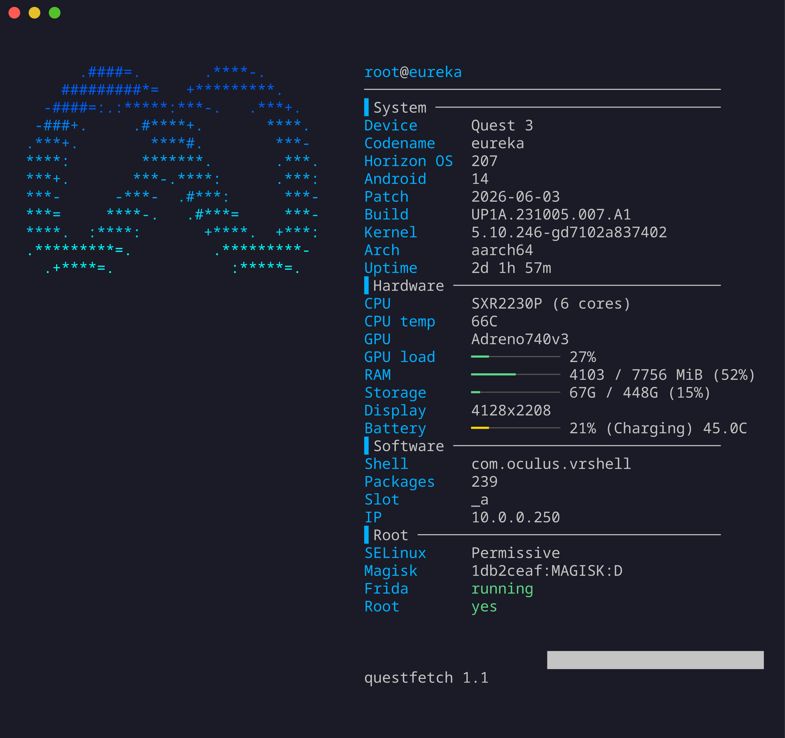
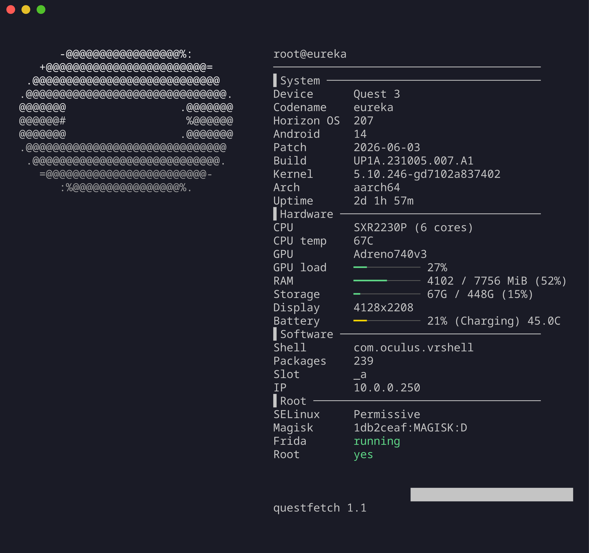
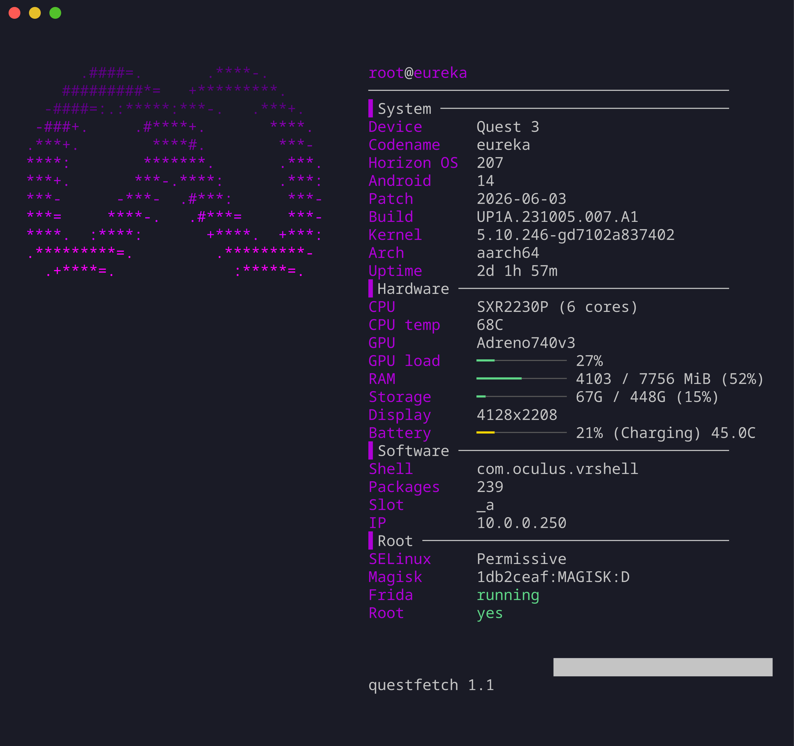
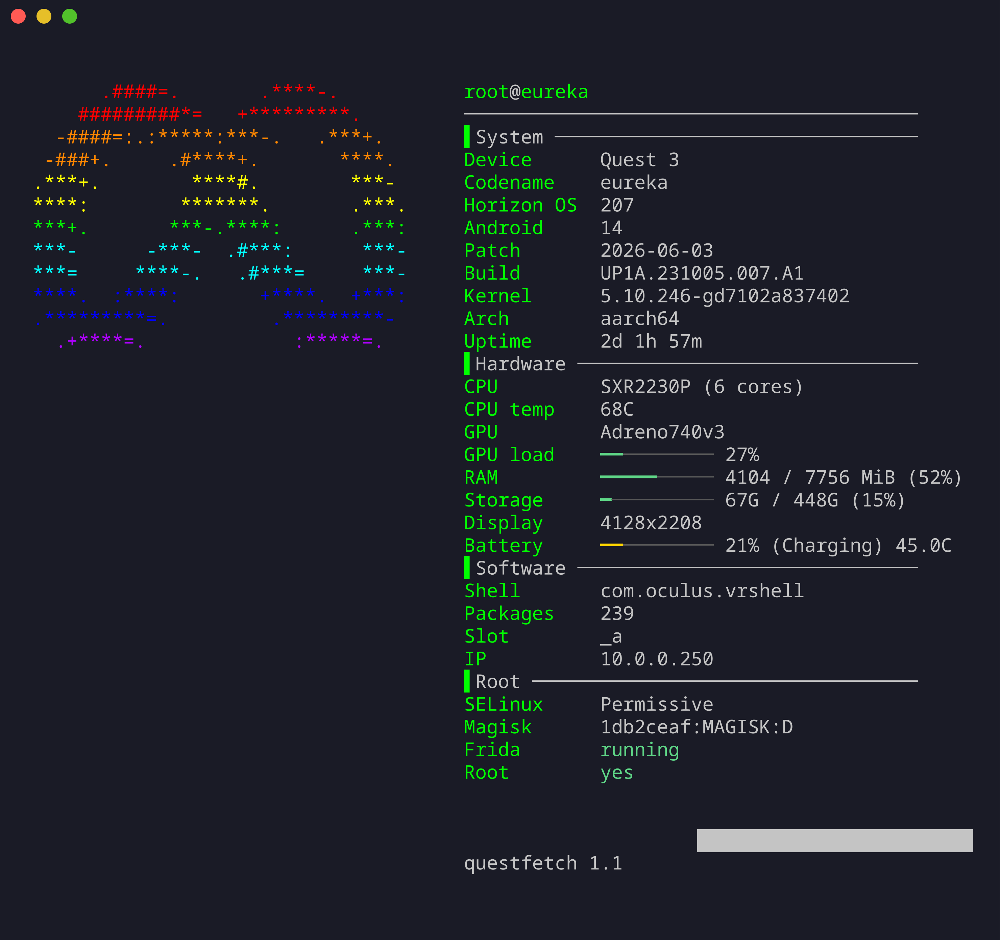
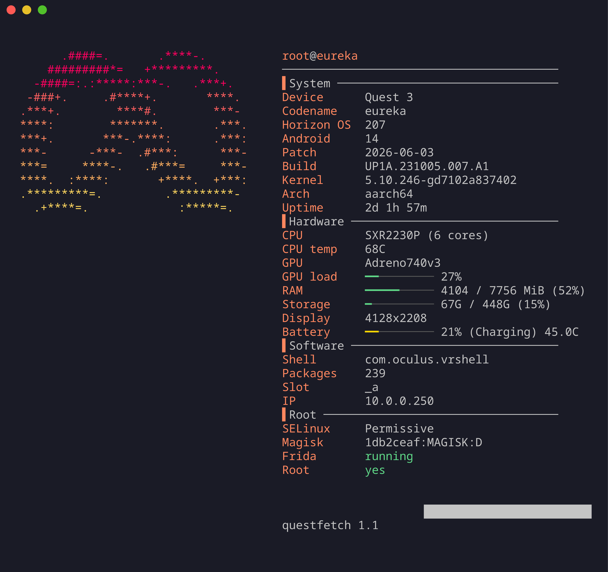
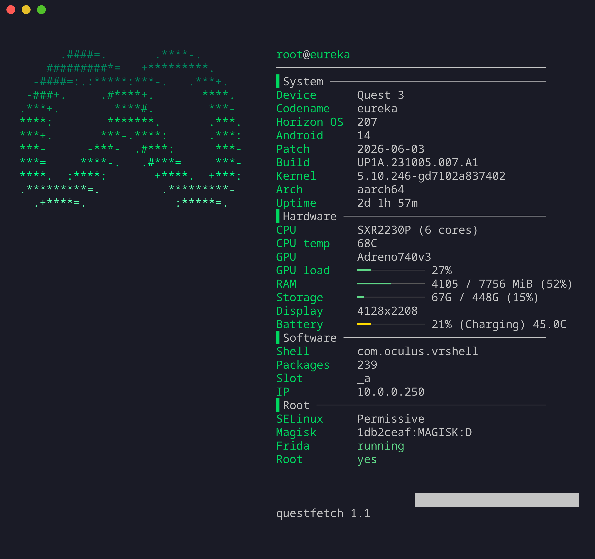
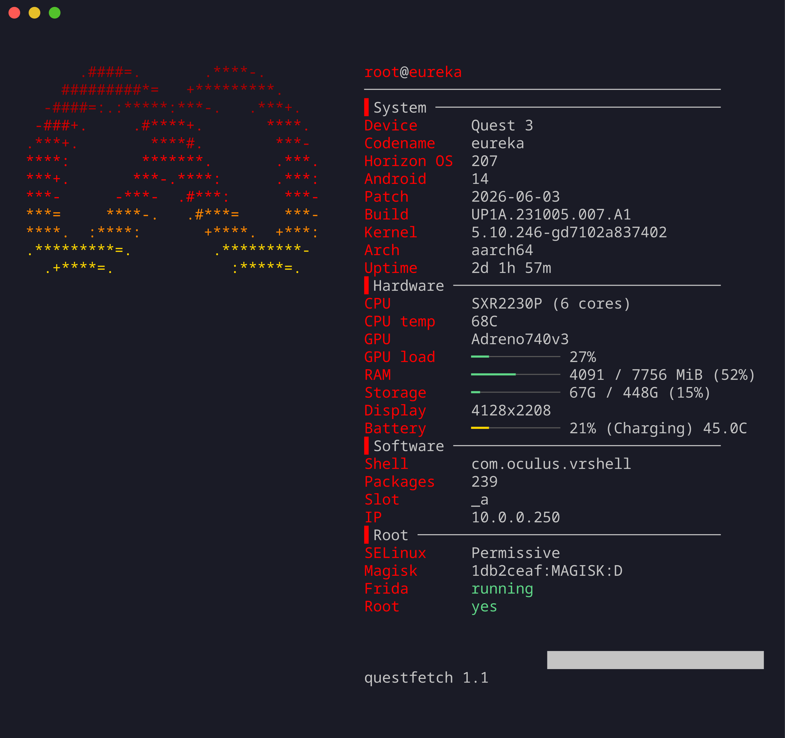
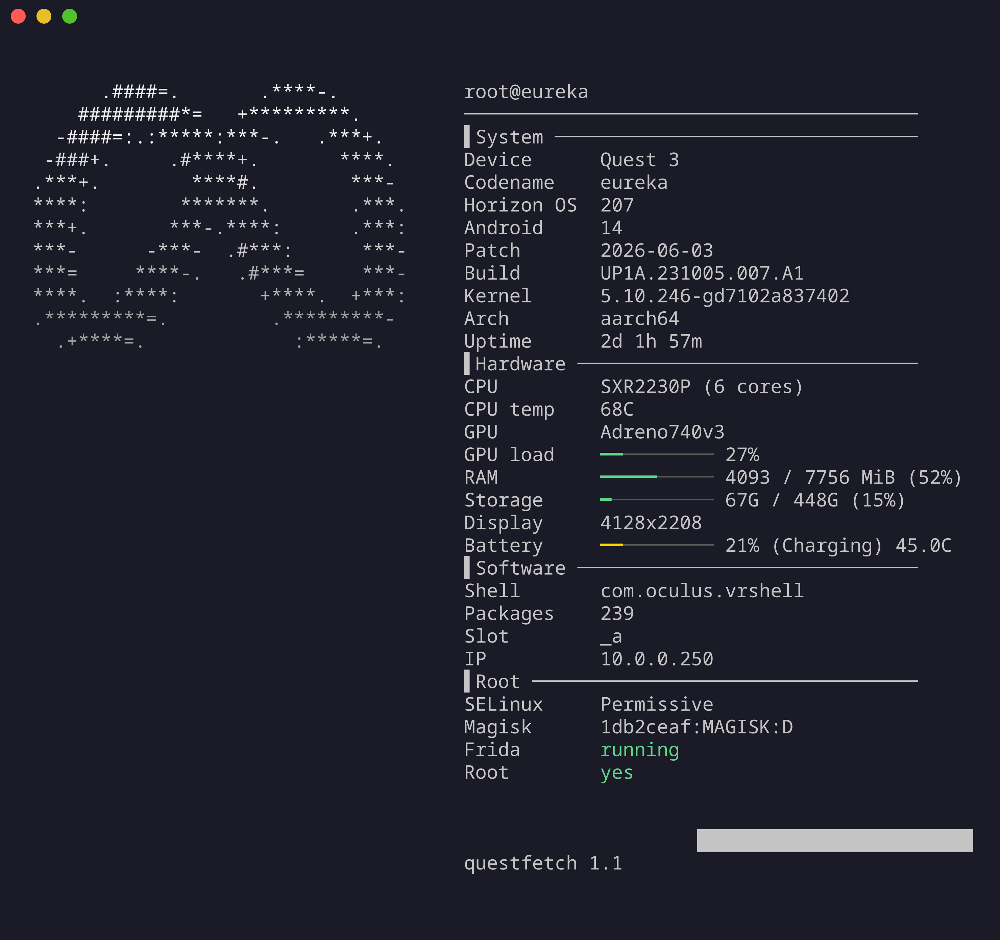
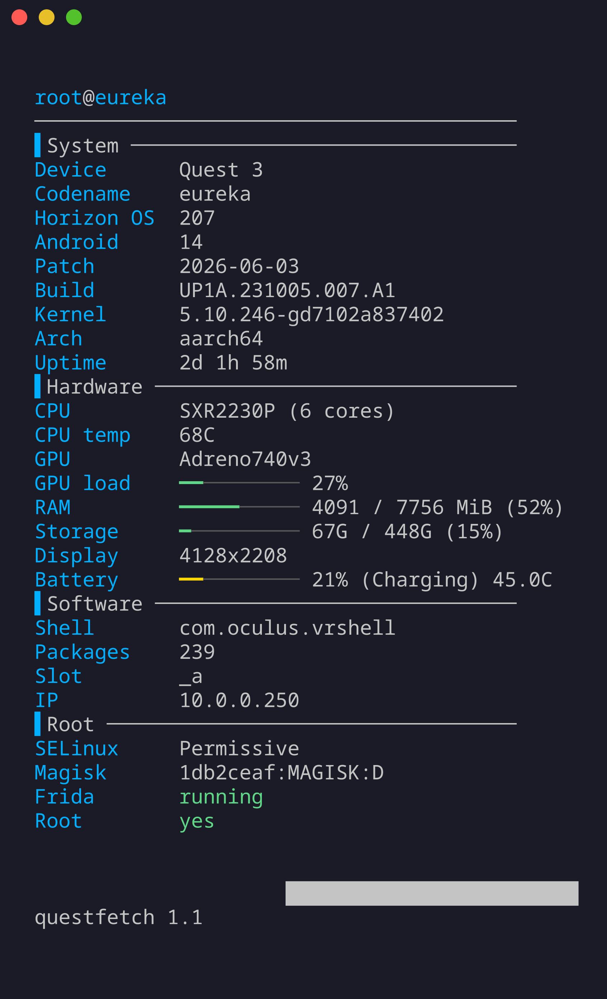

# questfetch

A fastfetch style system info tool for rooted Meta Quest headsets. Shows the Meta or Oculus logo with a color gradient, grouped sections, and live bars for RAM, storage, battery and GPU load.



## Features

- Meta logo in blue on newer headsets, Oculus logo in white on older ones (auto detected)
- Sections for System, Hardware, Software and Root
- Colored bars for RAM, storage, battery and GPU load
- CPU temp, battery temp, active slot, SELinux mode, Magisk version, Frida status
- 7 color themes, live watch mode, plain shell script with no dependencies

## Gallery

Colors and logos are picked with flags, see Usage below.

| Default (Quest 3, Meta logo) | Oculus logo (`-o`) |
| --- | --- |
|  |  |

| Purple (`-c purple`) | Rainbow (`-c rainbow`) |
| --- | --- |
|  |  |

| Sunset (`-c sunset`) | Mint (`-c mint`) |
| --- | --- |
|  |  |

| Fire (`-c fire`) | White (`-c white`) |
| --- | --- |
|  |  |

| No logo (`-n`) |
| --- |
|  |

## Requirements

- A rooted Quest (the script reads system files and runs commands that need root)
- adb on your computer, with the headset authorized
- Tested on a Quest 3 (Horizon OS v207, Magisk root). Other headsets should work but are untested.

## Install

```
git clone https://github.com/idoitthemodder/questfetch
cd questfetch
./install.sh
```

Make sure `~/.local/bin` is in your PATH, then with the headset connected over adb:

### Windows

Install [Android platform-tools](https://developer.android.com/tools/releases/platform-tools) and make sure `adb` is in your PATH, then in PowerShell from the repo folder:

```
powershell -ExecutionPolicy Bypass -File .\install.ps1
```

Open a new terminal and run `questfetch` with the headset connected. All the same options work (`questfetch -c mint -o`).

```
questfetch
```

Or skip the installer and run it by hand:

```
adb push questfetch.sh /data/local/tmp/questfetch
adb shell su -c 'sh /data/local/tmp/questfetch'
```

## Usage

```
questfetch [options]
  -m, --meta         force the meta logo
  -o, --oculus       force the oculus logo
  -n, --nologo       no logo
  -r, --random       random logo
  -c, --color NAME   blue purple rainbow sunset white mint fire
  -l, --list         show all color themes
  -w, --watch        live mode, refreshes every 2s
  -h, --help         help
```

## How the logo is chosen

By default it checks the device codename. Quest 1 (`monterey`) and Quest Go (`pacific`) get the white Oculus logo. Quest 2 (`hollywood`) gets the Oculus logo if its manufacturer or brand mentions Oculus, otherwise the Meta logo. Everything else (Quest 3, 3S, Pro and unknown devices) gets the blue Meta logo. The old headset detection is a best guess, so open an issue if yours picks wrong.

## Safety

The script only reads information. It does not write to any partition or system file. The installer only copies files to your home folder.

## Credits

Based on `qfetch` from [QuestRootResearch/Quest-Root-Research](https://github.com/QuestRootResearch/Quest-Root-Research).

## Disclaimer

Unofficial fan project. Not affiliated with or endorsed by Meta. Meta and Oculus are trademarks of their respective owners.

## License

GPL-3.0, same as the project it is based on. See LICENSE.
